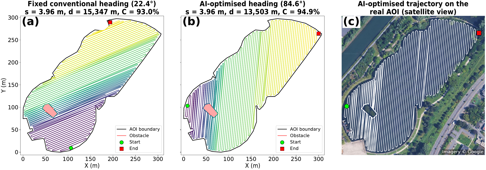
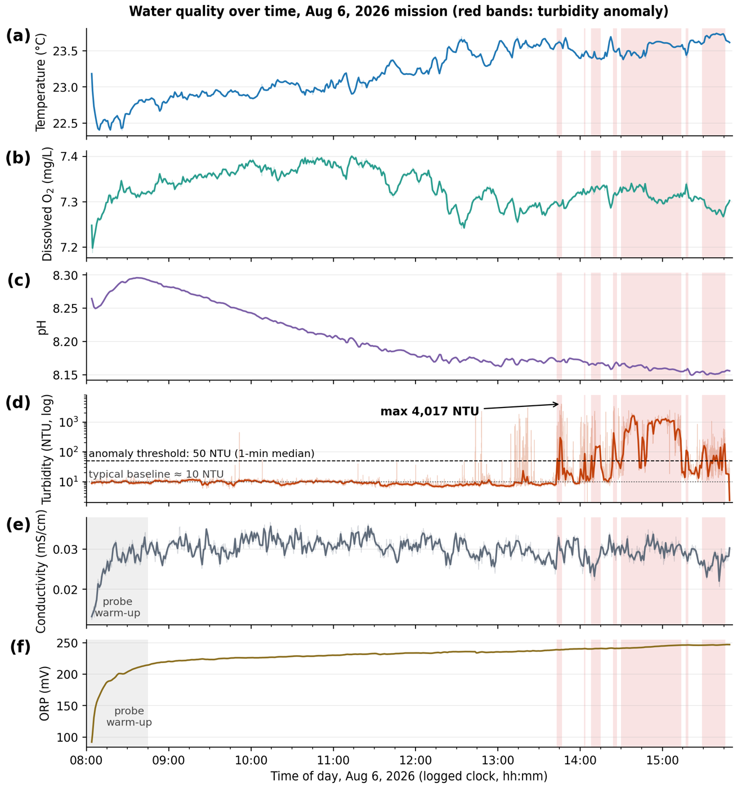

<h1 align="center">Integrating Mission Planning and Robust Control<br>for Water Quality Monitoring with an Aquatic Surface Drone</h1>

<p align="center">
  <b>Umar Alfa</b>, Auwal Shehu Tijjani, Luc Fabresse, Raymond Houe Ngouna, Eric Duviella, Adam Gouguet, Noury Bouraqadi<br>
  CERI Digital Systems, IMT Nord Europe, Univ. Lille &nbsp;·&nbsp; LGP, UTTOP Tarbes
</p>

<p align="center">
  
  
  
  <!-- <a href="https://doi.org/10.5281/zenodo.XXXXXXX"></a> -->
</p>

Code, data products and supplementary material accompanying the manuscript. The framework combines three modules, validated on the GOOSE surface drone on the Scarpe River (Douai, France):

| Module | Method | Folder |
|---|---|---|
| **Planning** | Differential-evolution (DE) coverage path planner optimising track heading and spacing on top of covplan | [`path_planning/`](path_planning) |
| **Control** | Nonlinear robust PID (NR-PID): adaptive nonlinear gains + smooth sliding-mode term | [`control/`](control) |
| **Estimation** | Multi-output Gaussian process (GP) with predictive uncertainty | [`water_quality/`](water_quality) |

## Highlights

- **Planner:** at equal track spacing, the optimised heading shortens the path by 0.9–12.0 % (mean 4.1 %) on four areas with up to six obstacles. In a field comparison, the planned path was 19.1 % shorter at comparable coverage (≈77 % vs ≈75 %).
- **Control:** NR-PID reduced field cross-track RMSE by 42.3 % and 24.3 % against a fixed-gain PID and an adaptive NLPID without the sliding-mode term (nominal conditions).
- **Estimation:** GP gives predictive uncertainty (84 % empirical coverage of the nominal 95 % interval) across six water quality parameters and four field missions.
- **Field result:** a localised turbidity anomaly was detected during the 6 August 2026 mission (peak 4,017 NTU).

## Gallery

<p align="center"><br><sub>Fixed conventional heading vs AI-optimised heading on a real area, with the planned path on satellite imagery.</sub></p>
<p align="center"><br><sub>Water quality over time on 6 August 2026; red bands mark the turbidity anomaly.</sub></p>

## Repository structure

```
├── path_planning/     DE path planner runs and ablation studies (length-only; heading-only vs heading + spacing)
├── control/           NR-PID, NLPID ablation and PID baseline (+ parameters of the field trials)
├── water_quality/     Raw-log parser, Aug 6 time series, GP video rendering (+ GP estimation code)
├── data/              Field data: control mission logs (CSV) and water quality sensor captures
├── figures/           Final figures of the paper
├── supplementary/     Supplementary document
├── video/             Mission videos (GP dissolved-oxygen overlay, multi-day animation)
└── docs/              Images used in this README
```

## Quick start

```bash
git clone https://github.com/Umaralfa-coder/integrating-mission-planning-robust-control-wq-drone.git
cd integrating-mission-planning-robust-control-wq-drone
python -m venv .venv && source .venv/bin/activate
pip install -r requirements.txt
```

| Task | Command |
|---|---|
| Smoke-test the controllers | `python control/test_nrpid.py` |
| Run the AOI8 path optimisation | `python path_planning/run_aoi8_de.py` |
| Heading-only / length-only ablations | `bash path_planning/ablation/hd.sh`, `bash path_planning/ablation/abl.sh` |
| Parse a raw sensor log and plot parameters over time | `python water_quality/parse6.py && python water_quality/plot6.py` |

Some scripts still contain absolute paths of the authors' machine; edit the input paths at the top of each script.

## Data format

Raw sensor logs (CoolTerm capture) follow
`DDMMYY;hhmmss.ss;lat;lon;alt;$PVHY2,…;1,Temp,DO%,DOmgL,…;2,T,pH,ORP,…;3,T,Cond,…`.

## Data

| File(s) | Content |
|---|---|
| `data/control_missions/*.csv` | Field trajectory logs of the NR-PID, NLPID and PID missions (10 and 18 August 2026) |
| `data/water_quality/coolterm_capture_2026-08-06_mission.txt` | Raw multiparameter sensor log of the 6 August 2026 mission |
| `data/water_quality/coolterm_capture_2026-09-04.txt` | Raw sensor log of 4 September 2026 |

Times in the sensor logs are the logged clock of the acquisition computer.

## Mission videos

- [`video/synced_video_mission1_with_GP_DO_compressed.mp4`](video) — field video synchronised with the GP dissolved-oxygen map.
- [`video/multiday_water_quality_animation.mp4`](video) — multi-day water quality animation.
- Full-quality recordings: see [`video/README.md`](video/README.md).

## Citation

If you use this work, please cite it (see [`CITATION.cff`](CITATION.cff)). The reference will be updated after publication.

## License

See [`LICENSE`](LICENSE).

## Contact

Umar Alfa · umar.alfa@imt-nord-europe.fr
